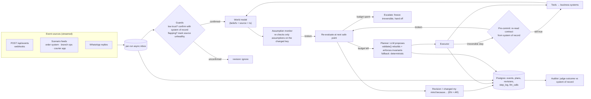

# Architecture - plan → execute → observe → re-evaluate

## The loop, in code
| Phase | Where | What happens |
|---|---|---|
| Plan | `app/core/planner.py` | The LLM drafts tool calls (JSON). `validate()` rebuilds every step from the registry, attaches each tool's **contract** (code-owned assumptions), and rejects plans that break invariants. Rejection → deterministic planner. |
| Execute | `app/core/agent.py` `_loop()` | Steps run one at a time. Re-evaluation happens only at **safe points** between steps, so nothing is half-done. Irreversible steps get a **pre-commit re-check** against the system of record. |
| Observe | `agent._consume()` / `_on_event()` | Each run has an async inbox. Events come from scenario feeds, WhatsApp replies and the public webhook. Low-trust events are confirmed against a second, authoritative source. |
| Re-evaluate | `AssumptionMonitor.broken()` → `agent._revise()` | Only assumptions that depend on the changed key are checked. A broken assumption on a not-yet-executed step schedules a revision: re-plan, ignore, or escalate when the budget is spent. |

## Why it is not "re-prompting on a timer"
- The agent has **no timers**. The only `sleep` is simulated API latency inside a step.
- Change detection is a dictionary lookup plus a predicate (`Assumption.holds`), not an LLM call. The LLM is called only after code has proven an assumption false.
- The same event that breaks the adaptive plan is delivered to the baseline, which ignores it. The difference in outcome is caused only by observing and re-evaluating.

## Customers are an event source
A WhatsApp reply arrives as `customer.reply`. Code classifies it (`classify_reply`: yes / no / info, English and Arabic) into `customer.consent`. `cancel_order`, `issue_refund`, `issue_voucher` and `confirm_booking` all carry the contract `customer.consent != "no"`. A "no" therefore breaks an assumption exactly like a courier webhook does, and the agent re-plans (with the reply in the prompt) or hands off. A question still ahead in the plan refreshes consent, so the monitor ignores consent for steps behind an unsent `ask_customer`. In **Try it yourself** a human plays the customer; 90 s of silence counts as no.

## Where assumptions come from
1. **Tool contracts** (hard, owned by code): `cancel_order` requires `order.status in [placed, preparing]`; `confirm_booking` requires the branch open ≥ 2 h after the slot and an active hold.
2. **Planner assumptions** (soft, proposed by the LLM): extra beliefs the plan relies on. Duplicates of contracts are dropped.
3. **Self-state** (`booking.*`) is produced by earlier steps of the same plan, so it is checked only at pre-commit, never by the event monitor.

## Persistence
Event-sourced, append-only tables (`app/store/db.py`): `sessions`, `runs`, `events` (with how each was handled), `plans` (every version), `revisions` (trigger, broken assumptions, reasons EN/AR, deciding planner), `step_log`, `llm_calls` (provider, model, latency, tokens, errors). `GET /api/runs/{id}/trace.md` renders a run as plain text.

## LLM layer
OpenAI-compatible failover chain: Groq (gpt-oss-120b) → OpenRouter (Claude Sonnet 5.5) → Gemini (3.5 Flash) → deterministic planner. Each call has a timeout. A provider that returns 401/402/403/429 or times out is skipped for 60 s (circuit breaker). Every attempt is logged in `llm_calls`.

## Fair comparison
Both runs in a session share the initial plan (planned once), the tool registry, and the scenario's event script, delivered on each run's own clock. Each run gets its own copy of the business systems, so the baseline's refund never leaks into the adaptive run. Outcomes are judged by `app/sim/audit.py` against the **system of record**, not the agent's beliefs. That is how a silent failure becomes visible.
