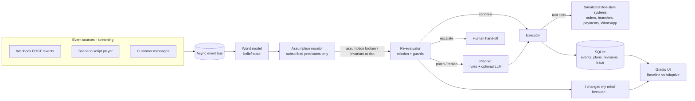

# The Adaptive Agent: execution plan

Status: approved 2026-11-10. Decisions on the open questions are in `../../../_shared/decisions.md`.
Challenge: build.doo.ooo/challenges/adaptive-agent ($500 + badge, about 5d 17h left at time of writing).
Repo: https://github.com/AhmedSAAhmed/The-Adaptive-Agent (empty today).

---

## 1. What the judges score, mapped to what we build

| Weight | Criterion | How we cover it |
|---:|---|---|
| 25 | Conceptual clarity: adaptation follows the mission, not random re-prompting | Every plan step lists **assumptions** (checkable statements about the world). The agent replans only when an incoming event **breaks a listed assumption** or threatens a **mission invariant**. There is no timer anywhere. |
| 25 | Technical depth: a real plan/observe/revise loop with saved state | Event-sourced loop: `plan → execute → observe → re-evaluate → (continue / patch / replan / escalate)`. Events, plan versions and revisions are stored in SQLite and can be replayed. |
| 20 | Demo quality: before/after obvious in 90 s | Side-by-side view: **Baseline** (sticks to the original plan) vs **Adaptive**, same event stream, with a live "I changed my mind because…" card. |
| 15 | Failure thinking | A dedicated scenario where adaptation itself goes wrong (a flapping or spoofed signal), and the guards that contain it. |
| 15 | Future thesis | `docs/THESIS.md`, at most 300 words. |
| Bonus | Non-adaptive baseline side by side | Built in (above). |
| Bonus | Streaming/event-driven inputs | An asyncio event bus, plus a public `POST /events` webhook so a judge can `curl` an event and watch the agent change its mind live. |
| DQ risk | "Re-prompt every N seconds" | Avoided by design: the re-evaluator runs only on events, and only for the assumptions subscribed to the changed keys. |

## 2. Domain: a Doo-style customer-service action agent

Doo runs AI customer-service agents on WhatsApp, voice and chat that **take actions in business systems** (refunds, bookings) for brands like Jahez and Albaik. That is the ideal setting: those actions are multi-step, cost money, are often irreversible, and the world (couriers, branches, stock, the customer) keeps moving.

### Scenario A: "Cancel my order and refund me" (money safety)
- Plan: verify order → check refund policy → cancel with restaurant → issue full refund → notify customer on WhatsApp.
- Key assumption: `order.status in {placed, preparing}`.
- Reality change (streamed webhook): the courier marks the order as `picked_up` while the agent is between step 2 and step 4.
- Baseline: issues a full refund for food that is already on the road. The plan "succeeds", but the business loses money silently.
- Adaptive: assumption A1 breaks → replans: stop the cancellation, offer a delivery-time update or a partial voucher per policy, and tell the customer why.

### Scenario B: "Book a table for 6 at 8 pm at the Olaya branch" (an outcome that doesn't exist)
- Plan: check availability → place a hold → collect preferences → confirm booking → send confirmation.
- Key assumption: `branch.olaya.open_until >= 22:00` and `slot.20:00.capacity >= 6`.
- Reality change: the branch posts an early-closure event (maintenance), or another channel takes the slot.
- Baseline: sends a confirmation for a booking that cannot happen. The failure surfaces only when the family arrives.
- Adaptive: replans to the nearest branch or slot, keeps the conversation's context (party size, preferences, language), and asks the customer before committing.

### Scenario C (failure test): "The flapping courier signal"
- A faulty or spoofed integration sends `picked_up → placed → picked_up → placed` within seconds.
- Naive adaptation: thrashes between plans and might even refund when the signal flips back.
- Containment (layered):
  1. **Confirm before believing**: a contradiction triggers a replan only when it comes from a trusted source or is confirmed by a second source within a window. This borrows Navy's "confirm from 3 regions before paging" idea.
  2. **Debounce/hysteresis**: a minimum dwell time before a state flip counts.
  3. **Replan budget**: at most N revisions per mission; past that → **escalate to a human** and freeze irreversible steps.
  4. **Pre-commit re-check**: every irreversible step (refund, confirm) re-checks its assumptions right before it runs: a two-phase *hold → verify → commit*.
  5. **Compensation**: reversible steps have an undo (release the hold, void a voucher).
- The demo shows the naive agent thrashing, then the guarded agent containing it and handing off to a human, with the trace explaining each decision.

Optional, if time allows: the customer switches language mid-conversation (English → Arabic), which changes the "how to communicate" assumption. A nice touch for a Saudi/Gulf audience, but not core.

## 3. Architecture



Core concepts (all Pydantic models):
- **Mission**: goal + invariants (e.g. "never refund goods already dispatched", "never confirm a booking without a held slot") + budget (max replans, max cost).
- **Plan / Step**: steps with `assumptions[]`, `reversible: bool`, `compensation`, `preconditions`.
- **Assumption**: `key`, `predicate`, `sources_trusted`, `confirm_window`. The monitor indexes assumptions by `key`, so an event touches only the assumptions that depend on it.
- **Event**: `source`, `key`, `value`, `ts`, `trust`.
- **Revision**: `trigger_event`, `broken_assumption`, `old_plan_v`, `new_plan_v`, `diff`, `reason` (human-readable), `decision` (patch/replan/escalate).
- **Baseline agent**: same planner, same tools, same event stream, but its monitor is switched off. One flag, so the comparison is fair and honest.

The planner runs in two modes:
- **Deterministic (default)**: rule-based replanning templates per scenario. The demo always works, costs nothing, needs no API key, and is reproducible for judges.
- **LLM (optional)**: an LLM proposes the new plan and the customer-facing explanation. The output is validated against the mission invariants before use; if validation fails, the deterministic plan is used. This is itself a containment layer worth showing.

Persistence:
- SQLite, event-sourced (append-only `events`, `plans`, `revisions`), so a run can be **replayed** from its events.
- Each run also exports `trace.md` (plain text) that a judge can open.
- Render free has an **ephemeral disk**: the DB resets on restart or sleep. Scenarios are seeded on boot, so the demo never looks empty. See question Q3 for durable options.

## 4. Stack (keeping it simple, Python only)

| Layer | Choice | Why |
|---|---|---|
| Language | Python 3.11 | Already installed on your machine |
| Core | `asyncio`, `pydantic` v2 | Event bus + typed models, no framework lock-in |
| API | FastAPI + `uvicorn` | A real `POST /events` webhook + SSE stream; Gradio mounts inside it |
| UI | **Gradio** (mounted with `gr.mount_gradio_app`) | Your preference; streams live updates from generators |
| Storage | SQLite (stdlib `sqlite3`) | Zero ops, works on Render free |
| LLM | Optional (see Q1) | Deterministic fallback keeps the demo free and stable |
| Tests | `pytest`, `pytest-asyncio` | ECC TDD + verification loop |
| Deploy | Render free web service, `render.yaml` blueprint | One-click redeploy from GitHub |

**Why not React/Next?** You asked for simplicity, and Gradio + FastAPI keeps everything in one Python process, one repo and one Render service.
**Gradio risk:** its default look is "Gradio-ish". We counter that with a custom `gr.themes.Base` + CSS built from the Navy tokens below. If Gradio styling limits us late on, the fallback is a single Jinja/HTMX page served by the same FastAPI app (no extra service).

### Render free constraints to design around
- The service sleeps after about 15 min idle; a cold start takes about 30–60 s. The README says so, and we wake the service before sharing the link.
- 512 MB RAM: no local models; keep dependencies lean.
- Ephemeral filesystem: seed on boot; no reliance on saved uploads.

## 5. UI: Navy theme tokens (pulled with Firecrawl)

From navy-astro.pages.dev:
- Background `#FAFBFF`, text/accent `#111428`, muted `#585D6F`, surface `#EAEEFC`, primary button `#DBDFFF` with `#111428` text.
- Font **Switzer** (free, Fontshare) for headings and body; h1 48 px / h2 36 px; 8 px spacing base.
- **Square corners (0 radius), no shadows**, thin borders. Section eyebrows styled `/// Section`, italic emphasis inside headings ("Know your app is _down_…").
- Their timeline pattern (12:04 Paged → 12:06 Acknowledged → Skipped) maps directly onto our revision trace.

Licensing note: Navy is a **paid** Lexington Themes template. We reuse only the *design tokens and visual language* (colours, font, spacing, square style), never its code, copy or images. See Q5.

Screens:
1. **Hero**: "Know your plan is _wrong_ before your customer does." Pick a scenario; Run.
2. **Side by side**: Baseline column vs Adaptive column, each with step states (✓ / ⏳ / ✗ / ↺), and the shared live event stream in the middle.
3. **"I changed my mind because…" timeline**: one card per revision: trigger event → broken assumption → old vs new plan diff → decision.
4. **Inject event panel**: send a custom event from the UI (or `curl` the webhook) to break the plan live.
5. **Architecture tab**: diagram + links to the repo docs.

## 6. Repo structure (ICM-architect + selected ECC parts)

Following icm-architect's invariants: a small `AGENTS.md` entry (under 60 lines, routing only), one-line pointer files for other harnesses, a `CONTEXT.md` contract per working folder, factory (`_shared/`) kept apart from product (`output/`), every stage ending at a check, numbered order.

Form choice: **Pipeline** for building and submitting the entry, wrapped around the application code. The code (`app/`) is the product; the stages tell any agent or person how the entry is built, checked and shipped.

```
The-Adaptive-Agent/
├── AGENTS.md                 # entry: where am I, where things live, where to go for task X
├── CLAUDE.md                 # one line: @AGENTS.md
├── CONTEXT.md                # the pipeline: stages, order, checks
├── README.md                 # judges' entry: live URL, 90 s Loom, clean-clone run
├── render.yaml  requirements.txt  pyproject.toml  .env.example
├── _shared/                  # FACTORY: stable every run
│   ├── mission.md            # challenge brief + scoring rubric (what "done" means)
│   ├── invariants.md         # safety invariants the agent must never break
│   ├── theme.md              # Navy design tokens
│   └── domain-doo.md         # Doo context: channels, actions, why adaptation matters
├── _templates/               # scenario.md, revision-card.md, stage-CONTEXT.md
├── _tools/                   # links.py (from icm-architect), check scripts
├── stages/
│   ├── 01_spec/              # CONTEXT.md → output/spec.md          check: rubric walk
│   ├── 02_core/              # CONTEXT.md → app/core/ built         check: pytest core
│   ├── 03_scenarios/         # CONTEXT.md → scenarios A, B, C        check: baseline fails, adaptive passes
│   ├── 04_ui/                # CONTEXT.md → Gradio Navy UI           check: screenshot review (person)
│   ├── 05_deploy/            # CONTEXT.md → Render live URL          check: clean clone + live smoke test
│   └── 06_submission/        # CONTEXT.md → Loom script, thesis, notes  check: person
├── app/                      # PRODUCT: the running system
│   ├── core/                 # models.py, bus.py, world.py, monitor.py, reevaluator.py, planner.py, executor.py, guards.py
│   ├── store/                # sqlite.py (event-sourced), export_trace.py
│   ├── sim/                  # fake Doo-style systems: orders, branches, payments, whatsapp
│   ├── scenarios/            # a_refund.py, b_booking.py, c_flapping.py (scripted event streams)
│   ├── baseline/             # non-adaptive agent (monitor off)
│   ├── api/                  # FastAPI: /events webhook, /stream SSE, /health
│   └── ui/                   # gradio_app.py, theme.py, navy.css
├── tests/                    # unit + scenario tests (baseline fails silently, adaptive adapts)
├── docs/
│   ├── ARCHITECTURE.md       # plan → execute → observe → re-evaluate snapshot
│   ├── FAILURE_TEST.md       # Scenario C: what goes wrong + containment
│   ├── THESIS.md             # at most 300 words
│   └── NOTES.md              # AI tools used, key decisions, out of scope
└── .claude/                  # selected ECC parts only (see below)
```

**ECC: take only what helps this project** (it ships 71 agents and 314 skills; loading all of them would bloat context, against ECC's own advice):
- Rules: `rules/common/{testing,security,git-workflow,coding-style}.md`, `rules/python/`.
- Skills: `python-patterns`, `python-testing`, `tdd-workflow`, `verification-loop`, `eval-harness`, `deployment-patterns`, `security-review`, `cost-aware-llm-pipeline`, `autonomous-loops` (for reference while designing the loop).
- Agents: `planner`, `architect`, `python-reviewer`, `code-reviewer`, `security-reviewer`.
- Attribution: ECC and icm-architect are both MIT; credit them in `docs/NOTES.md`.

Git rule: **no AI co-author trailers** in commits or PRs. Commits go under your own GitHub identity.

## 7. Day-by-day execution (about 5.5 days left)

| Day | Build | Exit check |
|---|---|---|
| **D1** (today/tomorrow) | git init, ICM scaffold (`AGENTS.md`, contracts, `_shared/`), ECC subset; core models, event bus, world model, assumption monitor, SQLite store; pytest setup | `pytest` passes for the core; `links.py` passes; walk test |
| **D2** | Planner (deterministic), executor, re-evaluator, guards; sim systems; Scenarios A and B; baseline agent; revision trace + `trace.md` export | Scenario tests: **baseline completes "successfully" but wrong; adaptive replans with a correct reason** |
| **D3** | FastAPI `/events` + SSE; Gradio UI with Navy theme; side-by-side view; revision timeline; inject-event panel | UI review from screenshots (you approve the look) |
| **D4** | Scenario C failure test + containment; optional LLM planner with invariant validation and fallback; Render deploy (`render.yaml`); README | Live URL works from a clean browser; clean `git clone` → `pip install` → run works |
| **D5** | `ARCHITECTURE.md` diagram, `FAILURE_TEST.md`, `THESIS.md`, `NOTES.md`; 90 s Loom script + shot list; polish | You record the Loom; submission checklist ticked |
| **Buffer** | Fixes, cold-start warmup, final submit | Submitted before the deadline |

### 90-second Loom outline (draft)
- 0–10 s: the problem: "Agents commit to a plan; reality moves."
- 10–45 s: Scenario A side by side. The courier webhook arrives; Baseline refunds; Adaptive shows "I changed my mind because order.status became picked_up, which breaks assumption A1…".
- 45–65 s: live `curl` to `/events` breaks Scenario B mid-run.
- 65–85 s: failure test: flapping signal → guarded agent stops thrashing and escalates.
- 85–90 s: architecture loop + repo link.

## 8. Risks and mitigations

| Risk | Mitigation |
|---|---|
| Looks like scripted theatre ("hidden logic" DQ) | Logic is in plain code, events are visible, the webhook accepts *any* event, and the README shows how to break it yourself |
| Render cold start during judging | Note in README; wake before submitting; keep dependencies small |
| LLM flakiness or cost | Deterministic planner is the default; LLM output is validated against invariants |
| Gradio theming limits | Custom theme + CSS; fallback to a FastAPI/HTMX page in the same app |
| Ephemeral DB | Seed on boot; optional free external Postgres (Q3) |

## 9. Open questions (please answer before D1 starts)

1. **LLM**: Should the replanner use an LLM at all, and which one (Claude, OpenAI, Gemini)? Do you have an API key you're willing to put in Render's environment variables? My recommendation: deterministic by default, with Claude as an optional switch.
2. **Scenarios**: Are you happy with Doo-style **refund (A)** and **booking (B)** plus the **flapping-signal failure test (C)**? Or do you know a specific Doo client flow (e.g. Jahez delivery, telecom plan change) they'd like to see?
3. **Persistence**: Is an ephemeral SQLite DB OK for the demo (seeded on boot), or do you want durable storage on a free external Postgres such as Neon or Supabase?
4. **ECC/ICM files in the repo**: Should the selected ECC rules, skills and agents be **committed into the repo** (`.claude/`), or installed only on your machine and kept out of the public repo?
5. **Navy theme**: Is it OK to reuse only the design tokens (colours, Switzer font, square style), since the Navy template itself is a paid product?
6. **GitHub push**: `gh` isn't installed here. Should I prepare commits locally for you to push, or will you set up git credentials so I can push to `AhmedSAAhmed/The-Adaptive-Agent`?
7. **Language**: Should customer-facing messages be bilingual (English + Arabic), as a nod to Doo's Gulf market?
8. **Loom**: Will you record it yourself from my script, or should I also prepare a scripted auto-play "demo mode" in the UI so it's easy to record in one take?
